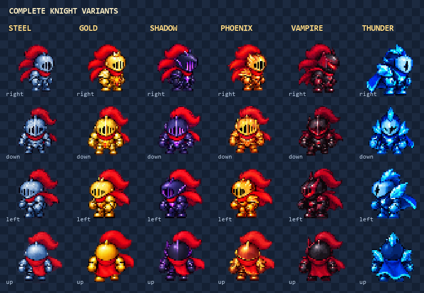

# One Hit Knight Arcade

Play `game/onehitknight.html` directly in a browser or through the existing site. No build step, Node runtime, or local server is required for play. Keep its `onehitknight/embedded-art.js` companion in place; this generated file contains the same optimized PNG pixels as the Cloudflare package and keeps artwork data separate from reviewable game logic. The downloadable standalone HTML in the delivery has these pixels inlined. Every arena and enemy remains playable before R2 is configured.

Move with WASD/arrows, slash with Space, dash with Shift, pause with Escape. Touch controls and standard gamepad movement/A/B/Start are supported. Slash follows the last movement direction and locks that direction for the duration of the swing. Anticipation is harmless; contact frames sweep the visible weapon sector; recovery returns to movement. Each target can be hit once per swing. Late windup hits are Perfect Strikes. Bosses open during late windup and recovery and fall to one well-timed strike.

Classic, Chaos, and 60 Second Mayhem retain their original progression and Firestore collection. The clock uses foreground wall time, including hit-stop and slow motion. Upgrade selection still occurs every three waves, with 23 equipment choices, three rarities and independent equipment slots. Armor swaps the complete animated knight: Steel, Gold, Shadow, Phoenix, Vampire or Thunder. The suit, helmet, limbs, boots and cape are drawn together in each character frame. Weapons stay separate, so each knight can carry any weapon. Thirty weighted pickups include the original ten and twenty additions. Seven short events and six arenas rotate during a run. Achievements unlock cosmetic starting styles without permanent stat advantages.

The settings screen controls sound/music volume, reduced shake and reduced flashes. Audio starts only after a user gesture. Simulation timers pause together and reset with each run; the deferred death menu is canceled on restart. Menus always allow return/restart even when online services are unavailable.

## Assets and deployment

See [Cloudflare integration](CLOUDFLARE.md). The graphics host setting, `window.ONE_HIT_KNIGHT_ASSET_BASE` near the top of the HTML, defaults to `https://pub-b50fd62dbbdf45b2aef043f19a0b7380.r2.dev/`. It loads the versioned manifest and relative PNG paths from that folder. Set the value to an empty string to use only the included image art; an explicit browser override also supports this. Critical art blocks the initial loading screen, while future enemies and arenas load ahead of their introduction. Missing remote images use the included PNGs and produce a delivery notice with retry.

The `arcade-v2-equipment` artwork ZIP includes six complete knight PNGs, nine separate weapon PNGs, the retained world artwork, animation rectangles/durations/directions/pivots, weapon timing/hitbox metadata, contact sheets and exact generation prompts. Each knight has four authored directional views and seven animation states. Its 224-cell sheet declares four idle frames and eight frames for each other state per direction. Each weapon has eight authored attack poses per direction; nonattack states use explicit held poses. Legacy `armor.*` sprite IDs point to complete characters for upgrade previews and are never drawn over another knight.

The individual character/weapon source PNGs, their subset manifest and exact generation prompts are also checked in under `art/`, so they can be inspected independently of the generated fallback data. The runtime uses the matching included data or the configured Cloudflare pack.



The manifest records intentional reuse. Standard enemies retain two movement poses; independent helmets, boots, capes and shields retain their earlier two-pose cycles. Those accessory upgrades preserve their own slots. Armor choices themselves use the complete character sheets, and Shadow/Phoenix choices do not add a second cape over the authored character.

Remote manifests must match the configured version. An older remote pack leaves the matching included art active while the replacement files are uploaded. Frame durations are expressed in milliseconds, including short anticipation poses.

## Leaderboard rules

A live read on October 24, 2026 confirmed anonymous authentication but returned `Missing or insufficient permissions` for the original leaderboard path. The PR includes a narrow fix in `firestore.rules`: authenticated reads and validated owner submissions at `lobbies/one_hit_knight/highscores`, independently of a multiplayer lobby parent. Existing World Quest rules remain unchanged. One Hit Knight submissions are immutable; ranking queries show the best ten without clients deleting other players' records. The shared lobby fallback excludes this score collection so it cannot bypass validation.

Deploy the reviewed rules to the existing `bible-game-246c0` Firebase project after merging. This PR does not deploy production rules. The game still accepts client-reported scores, matching the standalone architecture; rule validation does not independently replay a run.

## Development verification

Node is used only for development checks:

```text
npm run test:onehitknight
npm run test:onehitknight:browser
```

The browser suite uses the repository's Playwright dev dependency, with an installed Chromium browser. Set `CHROMIUM_PATH` if an explicit browser executable is needed. Tests create an instrumented temporary HTML copy; the production file has no eval-based test hook. Firebase is replaced by a deterministic adapter, so score write tests do not touch the live leaderboard. Screenshots and JSON results are written under the system temporary directory, or `OHK_TEST_OUTPUT` when set.

Set `OHK_ART_ROOT` to the extracted artwork folder to also exercise hosted manifest/image failures, upcoming-art preloading and retry through intercepted HTTP responses. These asset tests never contact a real asset host.

For the rules suite, start the Firestore emulator with project ID `demo-onehitknight`. Set `FIRESTORE_EMULATOR_HOST` to its local host/port, then run `npm run test:onehitknight:rules`. It loads the complete repository rules, verifies authenticated reads and valid submissions, rejects malformed/spoofed values, and verifies that update/delete and broad fallback bypasses are denied. It never connects to the production database.
