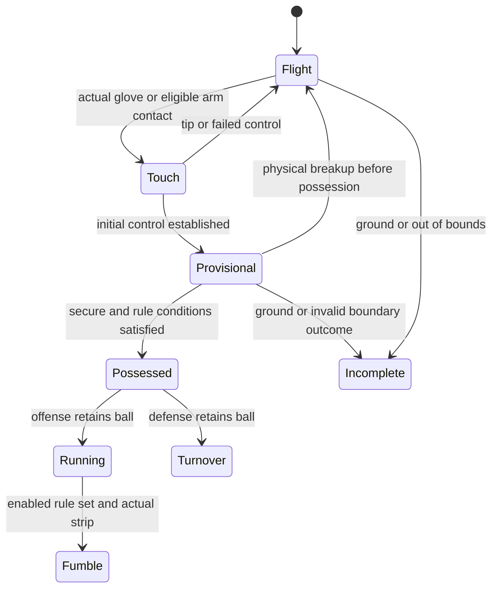

# Receiver Window QB gameplay and franchise upgrade design

Status: proposed design. Date: October 18, 2026. Repository baseline: `Sean-Pereksta/Magic` at `59e2628031fa7cfa0afb03280335e4f5cf77dbb4`.

## Intended experience

A quarterback should be able to beat tight coverage by throwing to the receiver's reachable far shoulder, leading away from an underneath defender, throwing behind a trailing corner, or placing a high ball beyond a shorter defender. The receiver must still track, reach, control and land with the ball. Defenders should visibly choose between protecting the completion, attacking the catch point, diving for a breakup and taking an interception risk. A missed attempt should leave a believable recovery opportunity for the offense.

Build this around the existing passing game, then add playable practice, short challenges, a season, a deeper roster and a larger market. Keep four receivers on the field. A bench and market expansion should add team decisions without adding simulation cost to every snap.

The most important rule is **the best placement is the safest catchable point against the entire defense**. Simply maximizing distance from the nearest corner can throw the ball out of bounds, outside the receiver's reach, or directly to a safety.

### What a player will notice

- Far shoulder throws create a real reach advantage. Poorly placed throws let defenders attack the exposed ball.
- Corners reach through available space, jump, rake the ball, dive to swat, or try a two-hand interception. They have to see and reach it.
- Receivers shield with their body, extend the far hand, secure with the second hand, drag their feet, or sacrifice running momentum to finish a difficult catch.
- Passing windows open and close over time. A receiver can be open at release but covered when the pass arrives.
- Skills Academy teaches those decisions through playable repetitions and contact replays.
- A four-player starting group gains eight bench places, personnel packages and a 48-player scouting market.
- The existing campaign gains separate exhibition, challenge, draft and season experiences, with rewards and records appropriate to each mode.

All new quantities and thresholds below are initial design targets for tuning. They are not measured professional football statistics or claims about implemented behavior.

## Existing systems and the gaps to address

The current game already has a strong physical foundation: rendered glove and arm contact shapes, swept ball contacts, tips, provisional catches, receiver dives, jump timing, delayed defensive observations, jointed animation and isolated replays. It also has 72 play concepts, receiver archetypes, uniform design and an opponent tour. Expand these systems rather than replacing them with a distance-based catch roll.

| Area | Current behavior | Proposed change |
| --- | --- | --- |
| Placement | `variety.js` returns a placement `hands` value, but `game.js` calculates placement after initial control succeeds and does not apply that value to control | Evaluate placement at the actual contact before control; use physical exposure and a small bounded handling adjustment |
| Contested control | Physical opposing contacts can break provisional catches; initial contests also use a small time grouping | Track each possession attempt and each separate opposing contact, with physical shielding and explicit secure/landing states |
| Defensive ball pursuit | Several corner, safety and robber branches pursue the eventual ground landing | Pursue reachable interception points along the airborne path |
| Defensive moves | Standing reach/high point exist; committed dives are currently post-catch tackles | Add distinct pass swats, diving swats, interception attempts and recovery states |
| Practice | Training purchases improve ratings; no separate playable drill system | Add repeatable, scored practice with replay coaching |
| Team | Four starters; signing immediately replaces one | Add a bench, stable player identity and saved personnel packages |
| Market | Five listings, paid full rerolls and a full reset after matchups | Add stable listings, comparisons, scouting and partial scheduled turnover |
| Mode lifecycle | Campaign paths automatically commit stats, chemistry, rewards and market changes | Introduce explicit session policies before adding other modes |
| Saves | Validation requires exactly four starters and five listings | Add a versioned migration for bench, larger market, modes and seasons |

Source entry points: [game.js](https://github.com/Sean-Pereksta/Magic/blob/59e2628031fa7cfa0afb03280335e4f5cf77dbb4/game/receiver-window-qb/game.js), [variety.js](https://github.com/Sean-Pereksta/Magic/blob/59e2628031fa7cfa0afb03280335e4f5cf77dbb4/game/receiver-window-qb/variety.js), [progression.js](https://github.com/Sean-Pereksta/Magic/blob/59e2628031fa7cfa0afb03280335e4f5cf77dbb4/game/receiver-window-qb/progression.js), [franchise.js](https://github.com/Sean-Pereksta/Magic/blob/59e2628031fa7cfa0afb03280335e4f5cf77dbb4/game/receiver-window-qb/franchise.js), and [README](https://github.com/Sean-Pereksta/Magic/blob/59e2628031fa7cfa0afb03280335e4f5cf77dbb4/game/receiver-window-qb/README.md).

## Ball placement and realistic passing windows

### Evaluate a future catch rather than a ground marker

Treat a window as a set of reachable points and arrival times, not a circle around a receiver. Use the same trajectory calculation as the actual throw, including loft, speed, gravity and the selected flight modifiers. For each receiver, project movement with acceleration, turning, route breaks and bounded adjustments. A sharp cut takes time; the receiver cannot instantly move to an attractive target.

For each candidate arrival, compute:

1. Receiver arrival time, body orientation, usable hands, jump/dive availability and landing space.
2. Every relevant defender's earliest legal reach along the full flight, including an underneath swat before the receiver's catch point.
3. Ball exposure around the receiver's shoulders, arms and torso, not just distance between player roots.
4. Required gather, likely running momentum, boundary footwork and contact risk.

Define the time advantage as `earliest defender contact time minus receiver control time`. Positive values favor the receiver, but do not guarantee possession. Compare normalized candidates using completion feasibility, time advantage, protected control, running opportunity and situation value. Reject unreachable or invalid landing candidates before scoring them. The recommendation may be a checkdown, a throwaway or no available window.

Use a small bounded search: begin with up to 12 placement candidates per receiver across up to 8 arrival samples. Reject distant actors cheaply before detailed reach tests. Evaluate coaching suggestions at a lower frequency than collision physics; live contact remains authoritative. Validate world-unit-to-yard conversion before tuning distances.

### Placement families

| Placement | When it helps | Cost or counter |
| --- | --- | --- |
| Far shoulder | Defender has inside or outside leverage on one side | Receiver must reach and turn; a second defender may own the far side |
| Leading throw | Receiver has acceleration and open space ahead | Overlead can become unreachable; a deep safety can undercut the path |
| Back shoulder | A trailing defender carries past the receiver | Receiver must decelerate and turn; a looking-back corner can react |
| High point | Receiver has a real height, jump or arrival advantage | Longer exposure, harder landing and less running momentum |
| Low and away | High defender leverage leaves a low protected target | Scoop/dive difficulty, reduced running opportunity and ground risk |
| Sideline placement | Outside leverage and enough landing room | Feet and body landing must qualify; outside alone is not safe |
| Between zones | The ball can arrive after one zone and before the next | Late release or excessive loft lets help arrive |

At physical receiver contact, compute a protection value from the ball's position relative to the nearby threat directions, receiver orientation, available shielding and exposed arm path. Use every defender who can threaten the control interval. A well-placed but fully extended one-hand catch may be safer from a swat yet harder to handle.

Start with a placement handling adjustment bounded to plus or minus 5 percentage points on the existing conditional control probability. Keep the routine catch floor/caps and two-hand advantage explicit in the tuning configuration. Do not award a bonus merely because the nearest defender is on the opposite side. Most of the improvement should come from reducing the defender's real contact opportunities, not stacking probability bonuses on already reliable catches. Avoid counting the same shield advantage again as a large generic strength bonus.

### Quarterback controls and feedback

Keep the existing center-reticle aim, hold/release passing, loft controls, pump fake and independent mobile look/throw zones. The trajectory preview and actual release must agree. Never bend a released ball toward the preferred shoulder or silently choose another receiver.

Add three assistance levels:

- **Coach:** while charging, show a receiver-height catch marker, a rough reachable region and one warning such as `SAFETY CLOSING` or `OUTSIDE REACH`. Show confidence bands rather than exact completion percentages.
- **Standard:** keep the catch-height marker and brief post-play placement feedback.
- **Simulation:** show the reticle and normal receiver identification; detailed window analysis is available after the play.

Optional pre-snap target preferences are Lead, Far Shoulder, High and Low. They guide receiver intent and coaching, without overriding the player's aim. Preferences cannot reveal hidden coverage or guarantee a specific animation. Automated receivers remain the default so the quarterback can concentrate on passing.

Teach anticipation: release before a break when the projected arrival is favorable; show `LATE TO WINDOW` when the same point was open earlier. Separate decision quality from execution in the replay. A sound decision can fail because of poor placement; a bad decision can occasionally succeed.

## Catch battles and possession

### Shared event model

Use the following sequence for both teams. A cosmetic catch pose never creates a possession event.

Preserve chronological swept contacts and the visible ball's three-lobe collision model. Advance the timeline to the next event, resolve it, and simulate the remaining interval from the changed state. Body obstruction must prevent an arm reaching through a torso to touch the ball. Arm length, joint limits, body rotation, jump offset and model scale must agree between rendering and contact.

The current 20/40 ms receiver securing durations are initial grip intervals, not a substitute for landing and catch-rule requirements. Separate grip completion, inbounds qualification and established possession. Allow a joint-control candidate when both opponents genuinely establish control at the same event time, then resolve retention and qualification under the selected rules. A second hand must actually arrive. No button press, rating, chest proximity or animation request can create contact.

The initial release keeps hand-first control and arm deflections. A later modeled arm cradle may initiate control only when an actual arm contact traps and carries the ball continuously inside constrained arm geometry; the chest alone cannot initiate a catch. Add this as a separate tested capability rather than enlarging the catch volume.

### Receiver choices

Receivers choose a feasible approach before contact, then adjust within their remaining physical limits:

- **Secure:** bring the ball into a protected two-hand pocket, accept reduced running momentum and prioritize the landing.
- **Attack:** meet the ball earlier with an extension or high point; expose it longer and accept landing/recovery cost.
- **Run through:** preserve stride when the pass can be controlled without an excessive reach.
- **Rescue:** scoop, toe drag or dive only when the committed body path can produce a real touch and valid finish.

Let the user set these preferences before the snap or in a receiver's profile. Resolve normal play automatically. A specialized receiver-control drill can expose the same actions manually without adding mandatory late buttons to quarterback play.

Strength affects body balance and resistance where actual bodies or limbs engage. Catching affects initial handling and retention. Athleticism affects reach speed, launch and recovery. Size affects actual geometry. Turning and cutting determine whether the player can align and slow down. Preserve diminishing returns above 100 and existing player investment.

### Catch rules

Provide an **Accessible** catch preset for the familiar quick possession experience and a **Simulation** preset with explicit feet, control and finish requirements. Difficulty and assistance are separate settings. Changing rules is permitted between sessions, not during a live play.

For the professional-style preset, control must be followed by qualifying inbounds contact and a football act or sufficient sustained control. A player who falls before completing the process can lose the catch at the ground. Genuine simultaneous retained control belongs to the passing team; a later grab is not simultaneous. These principles follow Rule 8, Section 1, Articles 3–4 of the [2026 NFL rulebook](https://static.www.nfl.com/image/upload/fl_attachment/league/tqivdkzt9mu6wdgsh1ku.pdf#page=37).

Use foot contact geometry and timed body states, including toe drags, rather than an arbitrary receiver-root boundary test. A held ball extending over a sideline is not alone enough to put a grounded inbounds carrier out. Classify the ball's status before resolving boundary/ground events. Uncontrolled flight out of bounds and an already-held ball require different checks.

Implement the relevant catch and interference rules as an explicitly scoped passing ruleset, not a claim of complete NFL simulation. Include arm restrictions, push-offs and early body interference; incidental ball contests remain possible. The contact distinctions come from Rule 8, Section 5 of the [same rulebook](https://static.www.nfl.com/image/upload/fl_attachment/league/tqivdkzt9mu6wdgsh1ku.pdf#page=40). Prevent illegal AI actions by default. Enable foul outcomes only after the mode can enforce the resulting down, spot and replay policy.

### Breakups, snatches and fumbles

Before established possession, an actual defender hand/arm strike can dislodge the provisional ball. A snatch requires the defender to obtain real control of the resulting loose ball; it cannot transfer possession by proximity. Both players may bobble and make another attempt after physical separation.

After possession, a strip is a separate fumble event. Introduce it only in modes with complete live-ball recovery, down/spot, boundary and scoring rules. Until that stage, defend a secured receiver through the existing tackle system. A downed player cannot be stripped retroactively, and a failed catch cannot be recorded as a fumble.

Give each opposing contact an episode ID. Evaluate residual handling uncertainty once per meaningful episode; require separation before a fresh attack can count. Use seeded random streams for handling, AI decisions and rewards, so extra frames, animation calls or replay viewing cannot create extra rolls or change the outcome.

## Defensive attempts and fair artificial intelligence

### Move selection

| Attempt | Physical action | Best use | Failure cost |
| --- | --- | --- | --- |
| Play through the hands | Short near-hand reach into exposed ball space | Tight coverage with limited clean interception access | Brief loss of balance or late tackle |
| Standing swat | Single arm extends to intersect the ball path | Reachable pass with poor two-hand control position | Reduced tackling readiness |
| Jump swat | One-hand high-point contact | Ball above standing reach | Landing delay and exposed running lane |
| Dive swat | Committed lateral/forward launch with one extended hand | Last chance to break up a reachable pass | Missed dive, slide and get-up time |
| Two-hand interception | Align both gloves and bring the ball under control | Defender reaches a clean path before the receiver | A failed grab may tip the ball or concede the catch |
| Diving interception | Layout with a controlled hand pocket | Clear turnover opportunity beyond standing reach | Harder control and longest recovery |
| Rake or rip | Short physical attack on an exposed provisional ball | Receiver touches first but has not established possession | Receiver may tuck first; defender loses tackle position |
| Secure the tackle | Stay balanced and contain after the catch | Breakup chance is poor or help is absent | Concedes the completion while limiting the gain |

Ball Hawks may accept interception risk; conservative defenders favor swats or containment. Fourth down and late-game context can favor a safe breakup over a difficult pick. Ratings change capability and decision quality within physical limits. A swat gets useful single-arm reach and deliberate impulse, while an interception needs a viable control pocket; neither receives invisible reach.

### Commitment and recovery

Use `track -> set -> commit -> contact or miss -> land -> recover`. Before commitment, the defender may cancel a poor option and stay in coverage. After takeoff, preserve momentum with only small bounded body adjustments. A defender cannot rotate around the receiver in midair, instantly change a missed swat into a pick, or launch again while getting up.

Initial tuning ranges: 120–220 ms set time where a plant is needed; 250–450 ms active dive; 450–900 ms landing/get-up cost; 800–1400 ms repeat-attempt cooldown. Continuous hand contact, not a broad active hit radius, decides success. Tune these ranges against pass speeds and animation readability. Preserve the separate post-catch tackle dive behavior.

Support defenders keep leverage while a teammate attacks the ball. Two defenders must not all commit to the same low-value dive. Use visible assignments and local threat ownership; double coverage should still produce genuine two-player contests.

### Perception and interception planning

Replace ground-landing pursuit with the earliest feasible airborne intercept. Solve movement, plant, jump/dive and hand reach together using the defender's observed ball state. During coverage, retain delayed receiver movement observations. After a defender sees the ball, predict from that observed state and refresh with delay; do not inspect the unreleased throw, hidden route assignment, drill answer or perfect future trajectory.

A defender facing away may react to receiver behavior, then turn to find the ball. That cue must not supply the ball's exact destination. High skill improves observation delay, angle and technique within configured bounds; it does not provide omniscience or recovery speed boosts. Record the observation and commitment times for replay coaching and fairness tests.

In defensive drills, offer remappable actions for Swat, Intercept and Dive Modifier, plus movement and player switching. Display bindings in the drill. Mobile uses labeled buttons outside the look area. Manual control uses the same move planner and physical limits as AI, without outcome bonuses.

## Game modes

All modes use the same catch engine. Establish the session/reward policy before routing any new mode into campaign lifecycle functions.

| Mode | Play experience | Persistence and rewards |
| --- | --- | --- |
| Campaign | Existing best-of-five opponent tour and rematches, with new catch systems | Preserve cash, records, progression and existing rematch payout rules |
| Exhibition | Choose opponent, coverage tendencies, venue, conditions and assistance | Separate match stats; no campaign advance, cash or market refresh |
| Free Practice | Any existing play and defense, instant reset, slow replay and optional overlays | No economic rewards or career stats |
| Skills Academy | Short lessons and ten-rep scored sets | Personal bests, medals and bounded first-clear rewards |
| Passing Lab | Receiver/defender isolation, then the existing four-receiver passing formation | Separate challenge results with selectable coverage and catch situations |
| Situational Challenges | Red zone, third-and-long, fourth-down breakup, two-minute drive and sideline clock management | Fixed seeds, stated rules, one-time milestone rewards and local bests |
| Draft Gauntlet | Draft four starters and two reserves from a fixed budget, then face a short opponent ladder | Temporary roster; separate records and capped completion reward |
| Season | Eight regular-season games, standings, roster decisions and a four-team playoff | Own season snapshot, budget and records; other teams' results and opponent offensive drives are simulated |

The initial Passing Lab uses the four existing receivers; offer a true seven-on-seven variant only when eligible-player and personnel support exists. The season is a passing-focused league: do not present its simulated opposing drives as playable full football. Full line play, rushing, special teams, two-way team ownership and online multiplayer are separate future projects.

Timed challenges need a game clock, explicit stop/restart events, timeouts and between-play runoff. Reuse the eight-second QB throw clock only as its own constraint. Do not implement a two-minute challenge as a decorative countdown over untimed campaign logic.

### Season rules for the first release

Use an eight-team league. Each team plays the other seven once, then a second game against its fixed rivalry partner, for eight regular-season games. Persist the schedule at season creation. Rivalry pairs are disjoint so every club gets the same number of games. Home/away assignment is cosmetic in this release and must not add hidden performance bonuses.

Each game gives each team four possessions using the existing 50-yard passing drive and first-down/down rules. A touchdown is worth seven; other drive endings score zero. Interceptions end the drive without a playable return. The user plays their four offensive drives. Opponent offensive drives and other league games use a seeded, versioned simulation that samples the same drive outcome scale from bounded team strength and coaching tendencies. Disclose this in the season screen. Freeze the game seed before the first snap; reloading resumes the same game. Alternate which team gets the final possession between home and away games, and show all remaining possessions.

Regular-season ties stand. Rank by winning percentage with a tie worth half a win, then tied-team head-to-head percentage, point differential capped at 14 per game, total points scored and stable team ID. Apply the same ordered criteria to a multi-team tie. The top four enter single-game semifinals, first versus fourth and second versus third, followed by a final. Tied playoff games use paired overtime drives from the existing start, with both teams receiving an opportunity each round; continue until a round has unequal scores. Alternate first possession each overtime round. Persist the overtime round and completed drive results.

For launch, provide four balanced 70 OVR starters, an empty bench and a separate $2,500 season wallet. New signings use visible signing prices and weekly salary costs. Initial salary bands are $20 below 70 OVR, $35 at 70–79, $65 at 80–89, $110 at 90–99 and $160 at 100 or above; bench salaries are half, rounded up. Snapshot the active/bench assignments at the weekly checkpoint. Reserve obligations before the week starts, settle once, and reserve any additional cost before a midweek signing or promotion. The original template costs $140 per week. Guaranteed participation income is $250 per completed game, with $150 for a win, $25 per touchdown up to $100, and $1,000 for the championship once. A tie earns participation and touchdown income but no win bonus. These are initial tuning values; test affordability over winning and losing seasons. Season rewards stay in the season wallet, and the championship closes the season before a separately confirmed new season is created.

### Reward eligibility and claim scope

| Activity | Payout schedule and cap | Destination | Stable claim key |
| --- | --- | --- | --- |
| Campaign/rematch | Existing once-per-matchup payout and rematch reduction | Campaign cash | Campaign instance plus matchup ID |
| Academy | $50 per newly earned bronze, silver or gold medal; $150 maximum per lesson for the life of that franchise | Campaign cash | Franchise instance plus lesson ID plus medal |
| Situational Challenges | Eight launch scenarios, $100 for the first qualifying clear of each; $800 lifetime launch-set maximum per franchise | Campaign cash | Franchise instance plus scenario ID plus first-clear milestone |
| Draft Gauntlet | Three fixed difficulty ladders, $250 for the first completed run on each; $750 lifetime launch-set maximum per franchise | Campaign cash | Franchise instance plus ladder ID plus completion milestone |
| Season | Published participation/result schedule, once per game; championship payout once per season | Season wallet only | Season instance plus game/championship ID |
| Exhibition, Passing Lab and Free Practice | No economic payout | None | No claim |

A direct gold Academy clear grants all three newly earned medals and pays at most $150 total. A later gold clear after bronze pays only the two unclaimed medals. Content revisions retain existing claim keys unless a genuinely new lesson/milestone is introduced; a balance patch cannot reset rewards. Practice, draft and challenge records remain separate from career stats and campaign advancement. Store claims, balances and completed results in the same candidate save. Persist successfully before presenting a payout or activating its balance. Independent franchise slots have independent wallets and ledgers, with no transfers between slots.

Difficulty changes observation delay, technique, tactical variety and rating templates. Assistance controls coaching information. Rules control catch/clock behavior. Save all three with the session, and show them beside personal bests. Open practice accepts existing franchise ratings; fixed-template challenges and draft records stay separate from unlimited-progression campaign records.

## Playable Skills Academy

Each lesson starts with a short demonstration, then offers unscored exploration and a ten-rep evaluation. Instant retry returns to the same seed; the next set introduces different leverage, personnel and timing. Start with 24 lessons across six tracks, then add advanced combinations.

| Track | Example lessons | What earns credit |
| --- | --- | --- |
| Placement | Far shoulder, low away, back shoulder, high point | Catchable protected placement at arrival, accounting for help defenders |
| Timing | Slant before the break, seam between zones, closing curl, layered cross | Release timing and safe flight path, not completion alone |
| Catch finish | Two hands under contact, toe drag, rescue dive, ground control | Real contact, valid feet/control and a completed finish |
| Defensive ball skills | Safe swat, dive breakup, high-point pick, avoid a bad gamble | Correct choice, physical contact and useful recovery |
| Coverage reads | Robber, bracket, rotation, pump-fake discipline | Choosing a viable target or correctly declining a dangerous throw |
| Team execution | Screens, option agreement, motion spacing, red-zone progression | Correct read, timing, spacing and eligible blocking |

Start scoring at 40% decision, 35% placement/timing and 25% execution/finish, with track-specific definitions. Show the three components and the actual outcome separately. A completion through an avoidable interception lane should not receive full decision credit. A correct throwaway can earn full decision credit in an appropriate scenario. Defensive completion denial matters more than chasing a pick on fourth down.

The replay can pause at release, first touch, opposing touch and possession/ground. Show the ball path, reachable hand region, available far shoulder and the first defender who threatened the flight. Use recorded observations for the defender view and a clearly labeled post-play analysis view for full information.

Practice never secretly improves ratings per repetition. Existing cash training stays available. Initial rewards: bronze/silver/gold at 60/75/90, with a maximum $150 total first-clear payout per lesson across all medals. Store claimed medal IDs; retries, reloads and replay skips cannot pay again. Keep medals optional for entering modes, recruiting and continuing the campaign.

## Team building and market

### Roster and roles

Keep `team` as the four active X/H/Y/Z profiles for compatibility, and add `bench` with capacity eight. Signing offers Sign to Bench or Replace a Selected Player, with a clear before/after comparison. Replacement sends the outgoing player to an available bench place. A full roster requires an explicit release choice; never silently delete a player.

Add saved personnel packages: Balanced, Speed, Possession, Red Zone and Screen. These store player IDs and role preferences, not copies. Validate four distinct available IDs before applying a package. Substitution is allowed between snaps, not during a pass or replay. Show fit for outside, slot, contested target, route technician and lead blocker using existing attributes and playstyles.

Persist jersey number, preferred alignment, role preference and appearance on the player. A move between starter and bench keeps ID, training, prestige, signatures, chemistry and career records. Numbers remain unique among owned players. Keep chemistry benefits modest; practice familiarity can guide timing without becoming a hidden large catch multiplier.

### Market with 48 stable listings

Show a compact searchable list with style, price, OVR, key ratings and a Compare action. Filters include affordable, role, archetype, physical build and standout skill. Allow three-player comparison and a six-player shortlist. Explain each listing's useful role rather than presenting only OVR.

Seed the initial pool with affordable specialists, balanced depth, developmental players and rare premium recruits. Continue using existing pricing and effective-rating rules as the baseline; review affordability against actual campaign earnings. Within the affordable cohort, generate viable catching, route, blocking and speed options. Avoid guaranteeing every elite attribute in every refresh.

Replace the full paid reroll loop with in-game market rounds. The campaign and each season own separate wallets, rosters, listing pools, shortlists, refresh indices, scouting allowances and transaction ledgers. At a completed eligible campaign matchup, replace up to 12 unowned campaign listings; at a season week transition, do the same only for that season's listings. Retain the remaining pool. Shortlisted listings are pinned until the player unpins them, with six pinned maximum. Browsing, loading, exhibitions and practice never refresh listings. Store the pool and refresh index so reload cannot reroll it. A bounded scouting refresh may replace up to six unpinned listings once per market round, with cost displayed before use.

Migration preserves all five existing campaign listings, IDs and cheaper legacy prices, then fills to 48. Signed listings leave the pool until scheduled restock; validation accepts zero through 48 current listings. Restock fills vacancies first within the round's 12-new-listing limit. Legacy elite rarity remains a recognizable baseline while role diversity increases. Market purchases and releases are atomic: verify the selected economy, cash, roster capacity, current listing ID and transaction ID; construct and validate a candidate save; persist it successfully; then activate it and update the interface. A failed write leaves the prior cash, listings and roster unchanged. Recover cloud/local divergence using explicit snapshots and transaction sequence numbers rather than replaying a purchase.

### Progression and season economy

Keep cash, prestige and uncapped legacy ratings in the existing campaign. Do not retroactively charge salaries for owned players or lower their ratings. Introduce contracts only inside new season saves, with an explicit salary budget and visible next-week cost. A season starts with its own selected template or drafted roster and cannot import uncapped campaign ratings into fixed-template records.

Season decisions include signing a specialist, developing depth, rotating packages, renewing a contract and releasing a reserve. Add fatigue only in the season, with visible recovery and an option to disable it for a casual season. Derive initial development traits deterministically for migrated profiles if ever needed; do not reroll their identity on load. Trades and rival-owned rosters are a later economy expansion, after valuations, contracts and transaction recovery are stable.

### Team and league identity

Extend the existing Home/Away designer with an alternate kit, stripe patterns, number styles, sleeve treatments, end-zone text and curated emblems. Show the selected opponent alongside the kit preview, with a readable-number contrast check. Preserve custom emoji emblems and individual player appearance.

Team identity should also affect football decisions: save a preferred personnel package, concept favorites, receiver roles and a scouting wishlist. Opponents combine a recognizable kit with a persistent coaching tendency, personnel strengths and season history. Retain the existing opponent identities and campaign records when adding this presentation.

## Interface and presentation

Use six main destinations: Play, Practice, Team, Market, Playbook and Records. Keep campaign continuation visible on Play. Rename the current rating-purchase screen Player Training so Skills Academy has a distinct purpose.

During a snap, keep the ball, receiver labels and reticle readable. Show at most one brief window cue. Use replay detail for explanations. Distinguish `OUT OF REACH`, `EXPOSED BALL`, `LATE WINDOW`, `REAL BREAKUP` and `FAILED FINISH`; do not label every failed pass a receiver drop. Animate takeoff, hand contact, second-hand secure, landing and get-up with the same rig used for collisions.

Menus must support keyboard, mouse and touch. Retain the two independent mobile control zones, native field behavior and focus restoration. Market results should paginate or virtualize; use lightweight previews rather than creating 48 live player models. Low graphics may simplify crowd, shadows and replay effects, but must preserve catch geometry and outcomes.

## Implementation structure and save migration

### Modules and integration points

| Proposed module | Responsibility | Current integration |
| --- | --- | --- |
| `pass-window.js` | Candidate arrival/reach analysis and coaching | `idealLaunchVelocity`, `drawTrajectory`, receiver pursuit and airborne defender targeting |
| `catch-battle.js` | Contact episodes, exposure, grip and possession events | `checkBallContact`, `receiverCatchControl`, `finishSecuringCatch`, `resolveCatch` |
| `defensive-ball.js` | Move feasibility, perception, commitment and recovery | `defenderTarget`, `updateDefender`, hand tracking and jump logic |
| `passing-rules.js` | Catch finish, feet, ground, boundary and scoped fouls | `physicsStep`, existing ground/boundary resolution and down/spot lifecycle |
| `modes.js` | Session settings, lifecycle, reward/stat policies and clocks | `endBall`, `endMatchup`, checkpoint, `F.commitPlay` and `F.finishGame` |
| `practice.js` | Seeded lessons, scoring, retries and reward claims | Shared session engine and replay events |
| `roster.js` and `market.js` | Packages, bench, listings and atomic transactions | `signReceiver`, market refresh, normalization and manager rendering |
| Existing presentation files | Menus, kits, stadiums, rig poses and replay views | `franchise-ui.js`, `presentation.js`, `style.css` and entry HTML |

Keep rules and simulation modules free of DOM calls. Pass explicit snapshots and return decisions/events. Retain `game.js` as the coordinator while extracting one working slice at a time. Avoid a simultaneous rewrite of all physics and persistence.

Each session declares `mode`, `rulesPreset`, `assistance`, `difficulty`, `seed`, `rosterSnapshot`, `statsPolicy`, `rewardPolicy`, `marketPolicy` and `checkpointPolicy`. Freeze the roster snapshot during a snap. Run finalization once with a session/play ID before routing events into the selected record book. Campaign and season records must not share an accidental unconditional commit path.

New statistics derive from resolved events: defended targets, actual contested attempts, breakups, interceptions, dive attempts/misses, protected placements and failed finishes. Replace the current proximity-only contested-catch classification for new plays with an actual opposing contact or feasible committed ball challenge. Version the metric so historical totals remain intact and are not presented as directly comparable measurements. Distinguish receiver handling drops from uncatchable passes and defender breakups.

### Versioned persistence

Add a payload `schemaVersion` independent of the existing local slot key. Migrate old local and decrypted cloud payloads through the same pure migration, then validate before changing the active slot. Preserve the original payload until the new write succeeds. The existing encrypted cloud transport can remain; extend its payload validation without weakening name/password or overwrite behavior.

The new payload keeps four active `team` profiles and adds bounded `bench`, `packages`, `marketState`, `practiceProgress`, `modeSessions` and optional `season`. Normalize all owned profiles, including bench, through the existing player and chemistry migrations. Resolve references by stable player/listing IDs. Bound arrays and reject duplicate owned IDs, invalid packages, malformed ratings and impossible transactions.

Resume campaign at a safe pre-snap checkpoint as today. Resume a challenge or drill at its last completed rep, without a second reward. Persist clock, seed and transaction sequence where relevant. Keep a season checkpoint separate from the campaign checkpoint. Active dive/contact states belong to live play and recorded replay, not a partially restored economy transaction.

Preserve existing ratings, training sessions, prestige, cash, starters, five listings, uniforms, career stats and campaign progress exactly. Add defaults without inventing prior season games or medal history. Future-version saves must fail with a clear message rather than being partially interpreted.

### Performance and replay

Run authoritative movement, perception, contact, clocks and random decisions on fixed 1/120-second simulation ticks with timestamped inputs. Rendering interpolates between completed ticks. Keep broad rejection checks, cache reach candidates and reuse vectors/buffers. Preserve elapsed active time through an accumulator; if an unusually slow frame exceeds the work cap, carry remaining time rather than skipping physical events. Reset the wall-time anchor on pause/resume so a hidden tab cannot trigger a burst of catch rolls. Define a stable input ordering for simultaneous events and stable actor IDs for contact ties. Guidance can run less often, but it must not change the authoritative state or consume handling randomness.

Add move state, contact episodes, grip/feet/possession flags and event timestamps to bounded replay data. Store important release/contact/possession/ground keyframes even when older general motion samples are thinned. Playback reads recorded events and transforms; it never reruns physics, AI, random decisions, statistics or rewards.

Initial performance gate: no more than 10% increase in the 95th-percentile active simulation time against the baseline on the same named desktop and phone-class devices, and no steady memory growth over 100 repeated snaps with replays. Measure first; name the devices and record the baseline before treating this as an achievable budget. Reduce suggestion search and presentation work before reducing authoritative collision quality.

## Delivery stages and acceptance

| Stage | Concrete scope | Exit requirement |
| --- | --- | --- |
| 1 Placement and catch foundation | Contact-time placement, exposed-ball analysis, event IDs, seeded handling, airborne reach planner and replay instrumentation | Paired throws prove useful far-shoulder placement; existing ordinary catches, aiming and saves still work |
| 2 Defensive attempts | Standing/jump/dive swats, clean and diving interceptions, rake, miss recovery and support discipline | Every move requires real contact, pays recovery cost and remains fair at different frame rates |
| 3 Catch finish and coaching | Feet/control/landing rules, preset selection, receiver preferences and post-play window analysis | Sideline, ground and simultaneous-control fixtures resolve correctly; mobile passing stays independent |
| 4 Mode layer and Academy | Isolated exhibition/free practice, 24 lessons, defensive controls and situational clocks | Practice cannot alter campaign records/market; reward claims are exactly once |
| 5 Team and market | Eight bench places, packages, 48 listings, shortlist, partial refresh and kit extensions | Legacy local/cloud saves migrate without losses; purchases, swaps and refreshes survive reload |
| 6 Draft and season | Draft Gauntlet, eight-game season, standings/playoffs, separate contracts and fatigue options | Complete and resume a whole season; budgets, bracket, records and rewards reconcile once |

Stage 1 should ship as a small testable vertical slice using an existing slant and fade against inside, outside and trail leverage. Include a second safety and a sideline case immediately so an outside-placement exploit is not baked into the design. Add later stages behind independent feature switches after their migrations and rules are complete.

### Required scenario checks

| Scenario | Required result |
| --- | --- |
| Same receiver and defense, same seed, near shoulder versus reachable far shoulder | Far shoulder increases defender reach-time margin and reduces breakups over paired trials; record initial control, secure completion and interception separately |
| Very far away, beyond the receiver's arm/body path | Incomplete even with elite ratings |
| Far from corner but toward safety | Safety threat reduces or removes the recommended window |
| Safe catch point but underneath defender intersects earlier | Full-path warning and actual swat remain possible |
| Ball passes through chest/head without glove or supported arm control | No possession |
| Defender's hand would need to pass through receiver torso | Reach is blocked; no invisible breakup |
| Receiver reaches first; defender contacts during control | One physical contest event can retain or dislodge; retries per frame cannot accumulate |
| Defender controls first; receiver grabs later | Defensive possession is not reassigned as simultaneous |
| True simultaneous retained control in Simulation preset | Passing team possession after qualification |
| Missed dive, receiver cuts afterward | Defender follows committed momentum and must land/recover |
| Defender is looking away | No exact ball-path pursuit before a valid observation |
| Actor iteration order or hidden route metadata changes without new observable movement | Contact winners and defensive decisions stay the same |
| Sideline toe drag, heel outside, falling catch, ball near ground | Each resolves by timed feet/control rules, with event order visible in replay |
| Replay, pause, retry or reload | No additional rolls, cash, chemistry, stats or market refresh |
| Sign twice rapidly, full bench, stale listing, failed save | No double charge, duplicate player or lost outgoing profile |
| Legacy local and cloud payloads | Preserve all existing assets and progress; fill new fields once |
| Fixed-template challenge versus 150-plus campaign ratings | Separate rosters and record categories |

Run deterministic fixtures at 30/60/120 render Hz and with irregular frame durations. Require matching event order/outcomes for identical seeds and inputs, with ball/contact position tolerance at most 0.03 existing world units in the fixture harness. Benchmark handling distributions across at least 1,000 paired seeds per representative leverage case; report confidence intervals rather than promising a universal completion percentage. Check protected placement, one-hand difficulty, routine catches, tips and clean interceptions separately.

Extend `gameplay-variety.test.cjs`, `variety.test.cjs`, `progression.test.cjs`, `franchise.test.cjs` and `cloud-save.test.cjs`, and add focused scenario suites for the new modules. Use the existing browser smoke, tactics and franchise checks plus new Academy/market flows. Check 360px portrait, phone landscape, desktop, keyboard focus, simultaneous touch gestures and low graphics. These are release requirements for implementation, not tests claimed to have passed for this design.

